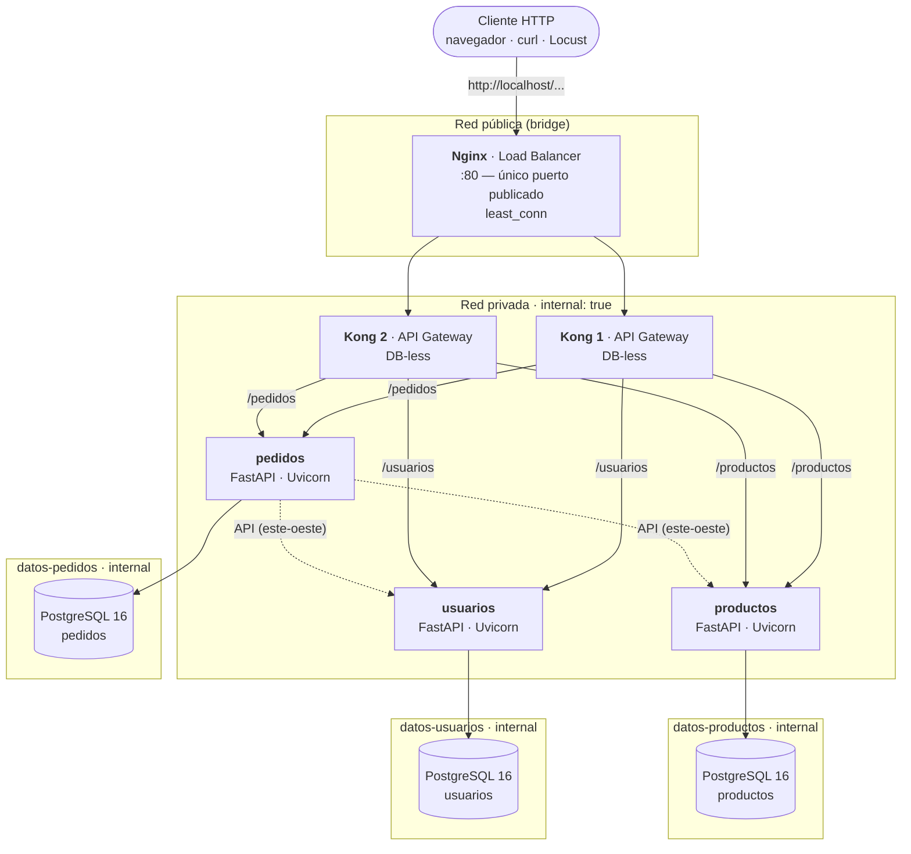

# Diagrama de la arquitectura implementada

## Flujo de una petición

1. El cliente llama a `http://localhost/usuarios`: el **único** puerto publicado (80, Nginx).
2. Nginx elige el nodo de Kong con menos conexiones activas (`least_conn`) y añade `X-Forwarded-For`.
3. Kong compara el prefijo (`/usuarios`, `/productos`, `/pedidos`), aplica los plugins globales
   (`correlation-id`, `rate-limiting`, `request-size-limiting`) y reenvía la ruta **sin recortarla**
   (`strip_path: false`) conservando el `Host` original (`preserve_host: true`).
4. El servicio FastAPI procesa la petición y consulta **solo su propia** base de datos.
5. Para crear un pedido, `pedidos` consulta las **APIs** de `usuarios` y `productos` (nunca sus BD).

## Matriz de alcanzabilidad (quién puede hablar con quién)

| Origen \ Destino | nginx | kong | usuarios | productos | pedidos | db-usuarios | db-productos | db-pedidos | Internet |
|---|---|---|---|---|---|---|---|---|---|
| Anfitrión        | ✅ :80 | ❌ | ❌ | ❌ | ❌ | ❌ | ❌ | ❌ | — |
| nginx            | — | ✅ | ✅* | ✅* | ✅* | ❌ | ❌ | ❌ | ✅** |
| kong             | ✅ | — | ✅ | ✅ | ✅ | ❌ | ❌ | ❌ | ❌ |
| usuarios         | ✅ | ✅ | — | ✅ | ✅ | ✅ | ❌ | ❌ | ❌ |
| pedidos          | ✅ | ✅ | ✅ | ✅ | — | ❌ | ❌ | ✅ | ❌ |
| db-usuarios      | ❌ | ❌ | ✅ | ❌ | ❌ | — | ❌ | ❌ | ❌ |

\* Técnicamente alcanzable por compartir la red `privada`; Nginx solo está configurado hacia Kong.
\*\* Nginx necesita la red `publica` para publicar el puerto 80.

## Decisiones de diseño

- **Dos nodos de Kong.** Con uno solo, el "balanceador" no balancea nada. Dos nodos idénticos
  (misma configuración declarativa) permiten demostrar el reparto y la tolerancia a la caída de uno.
- **Una red de datos por servicio.** La consigna "ninguna BD accesible fuera de la red privada" se
  endurece: además, ningún servicio puede siquiera resolver el nombre de la BD de otro. Así la regla
  *Database-per-Service* la impone la red, no la disciplina del programador.
- **Sin llaves foráneas entre servicios.** `pedidos` guarda `usuario_id` y `producto_id` y valida su
  existencia por API al crear el pedido (consistencia eventual; sin transacciones distribuidas).
- **Kong sin Admin API** (`KONG_ADMIN_LISTEN=off`): en modo DB-less no se necesita y reduce superficie.
- **Contenedores de solo lectura** (`read_only: true`), usuario sin privilegios (UID 10001) y
  `no-new-privileges`.
- **Coherencia con la guía.** La diapositiva 3 de la guía muestra Flask/MySQL y Django/SQLite en los
  servicios 2 y 3, pero el título, los objetivos, la tabla de herramientas y la fase 3 exigen FastAPI y
  "una base PostgreSQL por servicio". Se implementó esto último.
